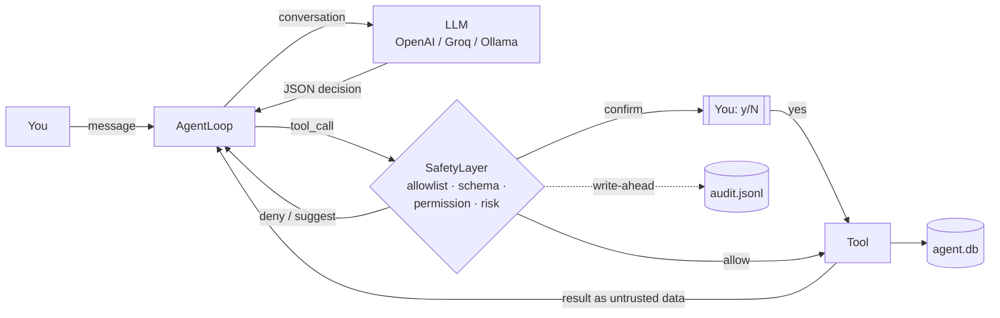

# Personal AI Agent

A command-line AI assistant built around one rule: **the LLM proposes, Python decides.**

The model never runs anything itself. Each turn it replies with a JSON decision: answer, ask a question, or call a tool. Before any tool runs, Python checks that decision against a schema, an allowlist, granted permissions, a risk level and your chosen autonomy level. Every decision is written to an audit log.

It works with OpenAI, any OpenAI-compatible API (Groq and others), or a **free local model through Ollama**.

> Status: milestone **V0.3** (conversation, tools, agent loop) plus the first **V0.4** slice (a persistent task list and an audit log). Planned features like long-term memory, GitHub and file tools, and a dashboard are **not built yet**. See the [roadmap](docs/architecture.md).

## Why build it this way

Agent frameworks often let a model's output trigger real actions directly. That's risky: models make mistakes, and text the agent reads (web pages, emails, tool output) can contain instructions written by someone else (prompt injection). This project takes the opposite approach and treats the model as untrusted:

| Layer | What it enforces |
|---|---|
| **Allowlist** | Only registered tools exist; anything else is denied |
| **Schema validation** | Arguments must match a Pydantic model (types, ranges, no unknown fields) |
| **Permissions** | Each tool needs a named permission, and none are granted by default (fail closed) |
| **Risk and autonomy** | `SAFE` / `CONFIRMATION` / `HIGH_RISK` tools are allowed, suggested or confirmed depending on `AUTONOMY_LEVEL`; `HIGH_RISK` always asks |
| **Untrusted output** | Tool results go back to the model inside labelled `<tool_result>` blocks that the tool's output can't close |
| **Budgets** | Maximum steps and tokens per run, bounded repair attempts for malformed JSON, LLM call timeouts, per-tool timeouts and output size limits, and a stop after repeated identical failures or repeated identical read calls |
| **Audit log** | Each safety decision is written to disk *before* the tool runs; if that write fails, the tool doesn't run |



## Features

- **Multi-turn CLI chat** with conversation history for the session
- **Tools:**

  | Tool | Risk | What it does |
  |---|---|---|
  | `calculator` | SAFE | Safe arithmetic (parsed with `ast`, never `eval`) |
  | `time_now` | SAFE | Current UTC time |
  | `echo_note` | SAFE | A note kept for this session only |
  | `task_list` | SAFE | Your saved tasks, earliest deadline first |
  | `task_add` | CONFIRMATION | Add a task, with an optional `YYYY-MM-DD` deadline (no past dates) |
  | `task_complete` | CONFIRMATION | Mark a task done by id |

  There is deliberately no delete tool.
- **Persistent tasks** in SQLite (`data/agent.db`)
- **Audit trail** in `data/audit.jsonl`, one JSON line per event (`run_start`, `tool_review`, `tool_confirmation`, `step`, `run_end`, and `tool_late_finish` when a timed-out tool completes afterwards). It records the decision, the reason, the risk level, an **args hash** and the result status. It never records your messages, raw arguments or successful tool output.
- **Any OpenAI-compatible provider**, using either the Chat Completions or the Responses API
- **Clear config errors.** A missing key or a typo in `.env` produces a one-line message naming the variable, never a stack trace or the secret itself.

## Example session

This is real output from a local `llama3.2` (3B) model through Ollama at autonomy level 2. Only the data file paths are shortened.

```text
Personal AI Agent (quit / exit to stop)
model=llama3.2 autonomy=2
tasks=...\data\agent.db audit=...\data\audit.jsonl

You: Add a task: submit the DBMS assignment, due 2026-10-20
Allow tool 'task_add' (CONFIRMATION) with args {'title': 'submit DBMS assignment', 'due_date': '2026-10-20'}? Autonomy level 2 requires confirmation before any tool runs. [y/N] y
Agent: (empty reply)
  [run=5302d7e1 status=DONE steps=2 tokens=2335+89]
  - Action: tool_call (ok)
  - Added task with id 1: submit DBMS assignment, due 2026-10-20, on 2026-10-12 (ok)

You: What tasks do I have?
Allow tool 'task_list' (SAFE) with args {'status': 'all', 'limit': 20}? Autonomy level 2 requires confirmation before any tool runs. [y/N] y
Agent: You have a task: submit DBMS assignment, due 2026-10-20.
  [run=3e426e55 status=DONE steps=2 tokens=2607+61]
  - Action: tool_call (ok)
  - Action: reply (ok)
```

The `(empty reply)` in the first turn is a real quirk of small models: the 3B model put its answer in the `summary` field instead of `text`. The task was still saved correctly, and the step summaries show what happened. Larger models follow the JSON format more reliably.

## Getting started

**Requirements:** Python 3.11 or newer (the code uses `enum.StrEnum`; developed and tested on 3.14), and either an API key or [Ollama](https://ollama.com) running locally.

```bash
git clone https://github.com/iwan-adler/personal-ai-agent.git
cd personal-ai-agent
python -m venv .venv
```

Activate the virtual environment and install the dependencies:

```powershell
# Windows PowerShell
.venv\Scripts\Activate.ps1
pip install -r requirements.txt
Copy-Item .env.example .env
```
```bash
# macOS / Linux
source .venv/bin/activate
pip install -r requirements.txt
cp .env.example .env
```

Then edit `.env` for your provider. `.env` is gitignored and must stay in the project root, never in `app/`.

| Provider | `OPENAI_API_KEY` | `OPENAI_BASE_URL` | `OPENAI_MODEL` (example) |
|---|---|---|---|
| OpenAI | your key | *(leave empty)* | `gpt-4o-mini` |
| Ollama (free, local) | any placeholder, e.g. `ollama` | `http://127.0.0.1:11434/v1` | `llama3.2` (after `ollama pull llama3.2`) |
| Groq | your key | `https://api.groq.com/openai/v1` | a model id from your Groq console |

Run it:

```bash
python -m app.main
```

Type a message, answer `y`/`N` when a tool needs confirmation, and type `quit` to exit. Each turn prints the run status, token usage and a one-line summary per step.

## Configuration

All settings live in `.env` ([`.env.example`](.env.example) documents each one).

| Variable | Default | Meaning |
|---|---|---|
| `AUTONOMY_LEVEL` | `2` | See the table below |
| `MAX_STEPS` | `8` | Model decisions allowed per message (1–50) |
| `MAX_TOKENS_PER_RUN` | `50000` | Token budget per message |
| `MAX_REPAIR_ATTEMPTS` | `2` | Times to ask the model to fix malformed JSON (0–5) |
| `LLM_TIMEOUT_SECONDS` | `60` | Per API call; the SDK retries up to 2 more times |
| `OPENAI_API_STYLE` | `chat` | `chat` (most compatible) or `responses` |
| `LOG_LEVEL` | `INFO` | Structured JSON logs go to stderr |

### Autonomy levels

| Level | Behaviour |
|---|---|
| 0 | Answer only (all tools denied) |
| 1 | Suggest tools, never run them |
| 2 | Ask `[y/N]` before every tool (default) |
| 3 | Run `SAFE` tools automatically; ask for the rest |
| 4 | Run `SAFE` tools automatically. A `CONFIRMATION` tool asks once per request and offers a **grant**: say yes and that one tool runs without asking for the rest of the request, up to 5 times in total. `HIGH_RISK` always asks |

### Reading the audit log

```powershell
Get-Content data\audit.jsonl -Tail 20     # Windows
```
```bash
tail -n 20 data/audit.jsonl               # macOS / Linux
```

## Tests

```bash
python -m pytest
```

There are 123 tests, which run in a couple of seconds with **no network and no API cost**. A `FakeLLMClient` replays scripted model replies. The tests cover:

- the agent loop: repair of malformed output, budgets, repeated-failure stops, and tool output that tries to break out of its `<tool_result>` block
- the safety layer: every autonomy level, missing permissions, `HIGH_RISK` always confirming
- config validation, and tool timeouts with a deliberately hanging tool
- the task workflow end to end: request → confirmation → SQLite → audit, including declined confirmations, invalid dates, missing permissions, persistence across sessions, and audit-write failures (the tool must not run)

## Project structure

```
app/
  main.py              CLI entry point; wires storage, tools, safety and the loop together
  agent/loop.py        THINK → ACT → OBSERVE loop, JSON parsing and repair, budgets, tracing
  safety/permissions.py  SafetyLayer: allowlist → schema → permission → risk vs autonomy
  tools/               Tool contract with timeouts, built-in tools, task tools
  memory/tasks.py      SQLite task store
  audit.py             Append-only JSONL audit log
  llm/client.py        OpenAI-compatible client wrapper + FakeLLMClient for tests
  config.py            Typed settings loaded from .env
docs/architecture.md   Design rationale, security invariants, roadmap
tests/                 pytest suite
```

## Limitations

- **CLI only**, for a single local user.
- **Conversation memory lasts only for the current session.** Only tasks persist.
- **Small local models are unreliable at the JSON format.** The repair loop fixes malformed output, but it can't make weak answers better (see the example session).
- **A tool timeout stops the agent waiting, but can't kill a stuck Python thread.** I/O tools must pass their own timeouts, as documented in `app/tools/base.py`.
- **No `HIGH_RISK` tools exist yet.** The confirmation path for them is implemented and tested, ready for future file, GitHub or shell tools.

## Roadmap

Each milestone is gated on the previous one being used and stable. The full table and its reasoning are in [docs/architecture.md](docs/architecture.md).

- **V0.4:** SQLite sessions and facts (tasks ✅ done)
- **V0.5:** GitHub, file and sandboxed Linux tools (these will be the first `HIGH_RISK` tools)
- **V0.6–V0.7:** knowledge graph, university tutor, planner and research with citations
- **V0.8–V0.9:** FastAPI, authentication, dashboard, then Docker and deployment

Deliberately **not** planned for now: voice, sending email, an unrestricted shell, and LangChain as the core.
