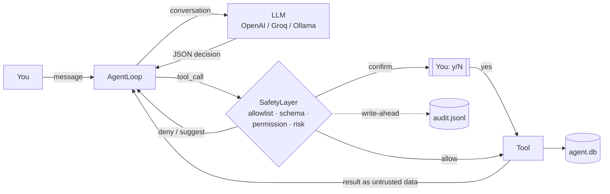

# Personal AI Agent

[](https://github.com/iwan-adler/personal-ai-agent/actions/workflows/tests.yml)

A command-line AI assistant built around one rule: **the LLM proposes, Python decides.**

The model never runs anything itself. Each turn it replies with a JSON decision: answer, ask a question, or call a tool. Before any tool runs, Python checks that decision against a schema, an allowlist, granted permissions, a risk level and your chosen autonomy level. Every decision is written to an audit log.

It works with OpenAI, any OpenAI-compatible API (Groq and others), or a **free local model through Ollama**.

> Status: **1.0.0** (see [CHANGELOG.md](CHANGELOG.md)): conversation, tools, agent loop and audit log; tasks, sessions and facts in SQLite (V0.4); workspace file tools and GitHub (V0.5, the Linux sandbox is postponed); a document library, courses and flashcards (V0.6); a planner, allowlisted web access, an opportunity scout and a citation check (V0.7); a local web interface with approvals and a dashboard (V0.8); local operations: health check, automatic backups and start scripts (V0.9). By design (D7) Koda stays on your computer: there is no deployment. See the [roadmap](docs/architecture.md).

## Why build it this way

Agent frameworks often let a model's output trigger real actions directly. That's risky: models make mistakes, and text the agent reads (web pages, emails, tool output) can contain instructions written by someone else (prompt injection). This project takes the opposite approach and treats the model as untrusted:

| Layer | What it enforces |
|---|---|
| **Allowlist** | Only registered tools exist; anything else is denied |
| **Schema validation** | Arguments must match a Pydantic model (types, ranges, no unknown fields) |
| **Permissions** | Each tool needs a named permission, and none are granted by default (fail closed) |
| **Risk and autonomy** | `SAFE` / `CONFIRMATION` / `HIGH_RISK` tools are allowed, suggested or confirmed depending on `AUTONOMY_LEVEL`; `HIGH_RISK` always asks |
| **Untrusted output** | Tool results go back to the model inside labelled `<tool_result>` blocks that the tool's output can't close |
| **Budgets** | Maximum steps and tokens per run, bounded repair attempts for malformed JSON, LLM call timeouts, per-tool timeouts and output size limits, and a stop after repeated identical failures or repeated identical read calls |
| **Audit log** | Each safety decision is written to disk *before* the tool runs; if that write fails, the tool doesn't run |



## Features

- **Multi-turn CLI chat** with saved sessions you can resume after a restart. Only the last `MAX_HISTORY_MESSAGES` messages are sent to the model each turn.
- **Tools:**

  | Tool | Risk | What it does |
  |---|---|---|
  | `calculator` | SAFE | Safe arithmetic (parsed with `ast`, never `eval`) |
  | `time_now` | SAFE | Current UTC time |
  | `echo_note` | SAFE | A note kept for this session only |
  | `task_list` | SAFE | Your saved tasks, earliest deadline first |
  | `task_add` | CONFIRMATION | Add a task, with an optional `YYYY-MM-DD` deadline (no past dates) |
  | `task_complete` | CONFIRMATION | Mark a task done by id |
  | `task_estimate` | CONFIRMATION | Set how many hours a task still needs; the prompt shows old and new |
  | `plan_week` | SAFE | Your study plan for the next days, computed in Python (not by the model) from deadlines, estimates, `STUDY_HOURS` and due flashcards, with warnings when time runs short |
  | `fact_search` | SAFE | Keyword search over what you told the agent in earlier sessions |
  | `fact_list` | SAFE | Saved facts, newest first, optionally one topic |
  | `fact_save` | CONFIRMATION | Remember a fact about you (up to 300 characters); you see the exact text first |
  | `file_list` | SAFE | List one folder inside `WORKSPACE_DIR` (only if it is set) |
  | `file_read` | SAFE | Read a text file inside `WORKSPACE_DIR`, up to 400 lines at a time, with its `sha256` |
  | `file_create` | CONFIRMATION | Create a **new** text file in an existing folder of `WORKSPACE_DIR`; the prompt shows the content |
  | `file_overwrite` | HIGH_RISK | Replace an **existing** file; the prompt shows a diff. Needs the `sha256` from `file_read`, so it only overwrites a file the agent has read and nobody has changed since. The old version is copied to `data/file-backups/` (last 20 kept) |
  | `web_fetch` | SAFE | Read one https page from a domain on `WEB_ALLOWLIST`: its text, title and the links you could follow |
  | `opportunity_scan` | SAFE | Read your `FEEDS` (RSS/Atom) and keep new entries that contain one of your `INTERESTS` |
  | `opportunity_list` | SAFE | Stored opportunities (default: new ones) |
  | `opportunity_save` | CONFIRMATION | Turn an opportunity into the task `Apply: <title>`, with a deadline and course if you give them |
  | `github_issue_list` | SAFE | Issues and PRs of a repo in `GITHUB_REPOS`, most recently updated first |
  | `github_issue_read` | SAFE | One issue or PR with its comments (text capped) |
  | `github_pr_list` | SAFE | Pull requests of a repo in `GITHUB_REPOS`, with branches and draft status |
  | `github_issue_comment` | HIGH_RISK | **Publish** a comment on an issue or PR in `GITHUB_WRITE_REPOS` |
  | `github_issue_create` | HIGH_RISK | **Publish** a new issue in `GITHUB_WRITE_REPOS` |
  | `doc_import` | CONFIRMATION | Import `.md`, `.txt` and `.pdf` files from `library/` in your workspace into the document library (unchanged files are skipped) |
  | `doc_search` | SAFE | Keyword search in your documents; every hit comes with a citation such as `lecture3.pdf, p. 12` |
  | `doc_list` | SAFE | The documents in your library |
  | `course_list` | SAFE | Your courses with open tasks, documents, facts and the next deadline |
  | `course_add` | CONFIRMATION | Add a course with a short code (`DBMS`), a name and an optional semester |
  | `course_update` | CONFIRMATION | Change a course's name or semester; the prompt shows old and new |
  | `card_propose` | CONFIRMATION | Save up to 20 flashcards at once; the prompt shows every question, answer and source |
  | `card_stats` | SAFE | Flashcard counts (total, due today, reviewed today, per course), never their text |

  `task_add`, `fact_save` and `doc_import` take an optional `course` to link the new item; `task_list`, `fact_search` and `doc_search` take one to filter. Exams are tasks linked to their course, so every deadline lives in one place.

  PDFs are parsed in a **separate process** (isolated, without your keys, killed after 60 s), because crafted PDFs can make parsers hang. Limits: 50 MB and 1,000 pages per PDF, 5 MB per text file. Encrypted PDFs are refused. OneNote notebooks can't be read directly: export them as PDF or Markdown into `library/`.

  Publishing always asks. The prompt shows the target (with the issue's current title), whether the repo is public, every @mention (they notify people) and the full text exactly as it will be posted. Text that looks like a secret (`sk-…`, `github_pat_…`, `ghp_…`, AWS keys, private keys) or contains one of your configured keys is refused before you are even asked.

  The file tools only reach the one folder you set as `WORKSPACE_DIR`. They can never see `.env`, keys (`*.pem`, `*.key`, `id_rsa*`), `.ssh` or `.git`, and they reject Windows path tricks (`..`, other drives, network paths, `file:stream`, `CON`/`NUL`, names ending in a dot, junctions or hard links leading outside). Anything they read counts as outside content: for the rest of that request, Level 4 grants are suspended and every write asks. The write tools never write types that Windows runs on double-click (`.exe`, `.bat`, `.cmd`, `.ps1`, `.js`, `.vbs`, `.lnk`, `.reg`, …), and there is no delete tool.

  No tool can delete anything. Facts and sessions are deleted only by your own `/forget-fact` and `/forget-session` commands.
- **Persistent storage** in SQLite (`data/agent.db`): tasks, chat sessions and facts, with numbered schema migrations. Sessions store only what you typed and the agent's final replies, never tool calls or tool results, so an instruction planted in an old tool result can't come back later.
- **Audit trail** in `data/audit.jsonl`, one JSON line per event (`run_start`, `tool_review`, `tool_confirmation`, `step`, `run_end`, and `tool_late_finish` when a timed-out tool completes afterwards). It records the decision, the reason, the risk level, an **args hash** and the result status. It never records your messages, raw arguments or successful tool output.
- **Any OpenAI-compatible provider**, using either the Chat Completions or the Responses API
- **Clear config errors.** A missing key or a typo in `.env` produces a one-line message naming the variable, never a stack trace or the secret itself.

## Example session

This is real output from a local `llama3.2` (3B) model through Ollama at autonomy level 2. Only the data file paths are shortened.

```text
Personal AI Agent (quit / exit to stop)
model=llama3.2 autonomy=2
tasks=...\data\agent.db audit=...\data\audit.jsonl

You: Add a task: submit the DBMS assignment, due 2026-10-20
Allow tool 'task_add' (CONFIRMATION) with args {'title': 'submit DBMS assignment', 'due_date': '2026-10-20'}? Autonomy level 2 requires confirmation before any tool runs. [y/N] y
Agent: (empty reply)
  [run=5302d7e1 status=DONE steps=2 tokens=2335+89]
  - Action: tool_call (ok)
  - Added task with id 1: submit DBMS assignment, due 2026-10-20, on 2026-10-12 (ok)

You: What tasks do I have?
Allow tool 'task_list' (SAFE) with args {'status': 'all', 'limit': 20}? Autonomy level 2 requires confirmation before any tool runs. [y/N] y
Agent: You have a task: submit DBMS assignment, due 2026-10-20.
  [run=3e426e55 status=DONE steps=2 tokens=2607+61]
  - Action: tool_call (ok)
  - Action: reply (ok)
```

The `(empty reply)` in the first turn is a real quirk of small models: the 3B model put its answer in the `summary` field instead of `text`. The task was still saved correctly, and the step summaries show what happened. Larger models follow the JSON format more reliably.

## Getting started

**Requirements:** Python 3.11 or newer (the code uses `enum.StrEnum`; developed and tested on 3.14), and either an API key or [Ollama](https://ollama.com) running locally.

```bash
git clone https://github.com/iwan-adler/personal-ai-agent.git
cd personal-ai-agent
python -m venv .venv
```

Activate the virtual environment and install the dependencies:

```powershell
# Windows PowerShell
.venv\Scripts\Activate.ps1
pip install -r requirements.txt
Copy-Item .env.example .env
```
```bash
# macOS / Linux
source .venv/bin/activate
pip install -r requirements.txt
cp .env.example .env
```

Then edit `.env` for your provider. `.env` is gitignored and must stay in the project root, never in `app/`.

| Provider | `OPENAI_API_KEY` | `OPENAI_BASE_URL` | `OPENAI_MODEL` (example) |
|---|---|---|---|
| OpenAI | your key | *(leave empty)* | `gpt-4o-mini` |
| Ollama (free, local) | any placeholder, e.g. `ollama` | `http://127.0.0.1:11434/v1` | `llama3.2` (after `ollama pull llama3.2`) |
| Groq | your key | `https://api.groq.com/openai/v1` | a model id from your Groq console |

Run it:

```bash
python -m app.main
```

Or double-click `scripts\koda.cmd` (chat) or `scripts\koda-web.cmd` (web interface) on Windows, or run `scripts/koda.sh` / `scripts/koda-web.sh` on macOS and Linux. They use the project's `.venv`, and you can pin a shortcut to them.

Type a message, answer `y`/`N` when a tool needs confirmation, and type `quit` to exit. Each turn prints the run status, token usage and a one-line summary per step.

Commands (handled by the CLI, never sent to the model):

| Command | What it does |
|---|---|
| `/sessions` | List recent sessions (`*` marks the current one) |
| `/resume [id]` | Continue a session; without an id, the most recent other one |
| `/new` | Start a new session |
| `/forget-session <id>` | Delete a session and its messages permanently (asks first) |
| `/facts [topic]` | List what the agent remembers about you |
| `/forget-fact <id>` | Delete a remembered fact permanently (asks first) |
| `/opportunities [status]` | Opportunities from your feeds: `new` (default), `saved`, `dismissed` or `all` |
| `/dismiss <id>` | Hide an opportunity (asks first); only you can dismiss, not the model |
| `/plan [days]` | Your study plan for the next days (default 7, at most 28) |
| `/quiz [course] [n]` | Study due flashcards: Enter shows the answer, then grade 1 again, 2 hard (comes back a little later, like Anki), 3 good, 4 easy (`q` stops; every grade is saved at once). Runs without the model |
| `/cards [course]` | List your flashcards with their due dates |
| `/forget-card <id>` | Delete a flashcard and its review history (asks first) |
| `/courses` | List your courses with counts and the next deadline |
| `/forget-course <code>` | Delete a course; its tasks, facts and documents stay, unlinked (asks first) |
| `/docs` | List the documents in your library |
| `/forget-doc <id>` | Remove a document from the library; the file itself stays (asks first) |
| `/help` | Show the list |

Each launch starts a new session; it is saved from your first message on.

> **Privacy:** your messages, the agent's replies and saved facts are stored **unencrypted** in `data/agent.db`, and backups of overwritten files in `data/file-backups/`. The file is gitignored, but anyone with access to your computer can read it. The audit log never contains them, only ids.

### Web interface

```bash
python -m app.web_ui
```

Prints a one-time link such as `http://127.0.0.1:8765/?token=…`. Opening it signs you in (the token moves into an HttpOnly, SameSite=Strict cookie and leaves the address bar). The page offers the same agent as the CLI: when a tool needs your approval, a card shows exactly what the terminal would ask, with **Approve** and **Decline**; the run continues where it paused. A read-only **Dashboard** shows this week's plan with its warnings, open tasks, courses, flashcards due and new opportunities. Keep the link private: anyone with it can use the agent while the server runs. The server only listens on `127.0.0.1`, refuses requests for other host names, other sites' form posts and pages without the token, and renders every model and tool text escaped under a strict Content-Security-Policy.

### Backups

Koda backs up `data/` automatically when the CLI or web interface starts, at most once a day, and keeps the newest 10 (in `data/backups/`, or `BACKUP_DIR`). The database is copied with SQLite's backup API, so a backup is consistent even while Koda runs.

```bash
python -m app.backup                 # back up now
python -m app.backup --list
python -m app.backup --verify FILE   # check a backup
python -m app.backup --restore FILE  # asks first
```

Restoring checks the backup first (integrity, schema version, no unexpected files), asks, and backs up your current state before replacing anything. Stop Koda before restoring. Backups contain your data unencrypted, like `data/` itself.

### Health check

```bash
python -m app.doctor
```

Read-only checks with `[ok]`, `[warn]` or `[FAIL]` (exit code 1 on any failure): settings load, database integrity and schema version, audit log readable, free disk space, `.env` ignored and untracked by git (its contents are never read), and installed package versions matching `requirements.txt`. It never contacts the network or the model provider and never changes the database.

### Sources and citations

Answers based on your documents or a fetched page cite them in square brackets, e.g. `[dbms/lecture3.pdf, p. 12]` or `[https://en.wikipedia.org/wiki/Join]`. After every answer, Python compares each citation with the sources the agent **actually read in that request**. Anything else is flagged at the end of the answer:

```
⚠ Unverified source(s), not read in this request: [dbms/lecture9.pdf, p. 7]
```

## Configuration

All settings live in `.env` ([`.env.example`](.env.example) documents each one).

| Variable | Default | Meaning |
|---|---|---|
| `AUTONOMY_LEVEL` | `2` | See the table below |
| `MAX_STEPS` | `8` | Model decisions allowed per message (1–50) |
| `MAX_TOKENS_PER_RUN` | `50000` | Token budget per message |
| `MAX_REPAIR_ATTEMPTS` | `2` | Times to ask the model to fix malformed JSON (0–5) |
| `LLM_TIMEOUT_SECONDS` | `60` | Per API call; the SDK retries up to 2 more times |
| `STUDY_HOURS` | *(empty)* | Study hours per weekday for the planner, e.g. `mon=2,tue=2,wed=3,thu=2,fri=1,sat=4,sun=0` (0–16 each, missing days are 0). Empty means 2 h every day, and the plan says so |
| `BACKUP_DIR` | *(empty)* | Absolute path of an existing folder for backups, not inside `WORKSPACE_DIR`. Empty means `data/backups/` |
| `WEB_UI_PORT` | `8765` | Port of the local web interface (1024–65535); it only ever listens on `127.0.0.1` |
| `MAX_HISTORY_MESSAGES` | `20` | Recent messages sent to the model each turn (4–200) |
| `WORKSPACE_DIR` | *(empty)* | Absolute path of the only folder the file tools may read, e.g. `C:\Users\you\Documents\koda-workspace`. Empty means no file tools. Not allowed: a drive root, your home folder itself, or a folder containing this project |
| `WEB_ALLOWLIST` | *(empty)* | Comma-separated domains `web_fetch` may read, subdomains included (max 50). **Never list shared hosting** such as `github.io` or `blogspot.com`, where anyone can create a subdomain. Empty means no web tools |
| `FEEDS` | *(empty)* | RSS/Atom feed URLs for the opportunity scout (max 20). Each must be https on a `WEB_ALLOWLIST` domain |
| `INTERESTS` | *(empty)* | Keywords an entry must contain, as whole words in any case, e.g. `internship,werkstudent,python,c++` |
| `GITHUB_REPOS` | *(empty)* | Comma-separated `owner/name` repos the GitHub tools may read (max 20). Empty means no GitHub tools |
| `GITHUB_TOKEN` | *(empty)* | Optional. Without it, public repos work at 60 requests/hour. Recommended: a **fine-grained** token limited to those repos, with read-only *Metadata*, *Issues* and *Pull requests*. Removed from the environment once loaded, like the OpenAI key |
| `GITHUB_WRITE_REPOS` | *(empty)* | Repos the agent may **publish** to; each must also be in `GITHUB_REPOS`. Empty means no write tools |
| `GITHUB_WRITE_TOKEN` | *(empty)* | Required with `GITHUB_WRITE_REPOS`: a **separate** fine-grained token limited to those repos, with *Issues: Read and write*. Used only by the write tools |
| `OPENAI_API_STYLE` | `chat` | `chat` (most compatible) or `responses` |
| `LOG_LEVEL` | `INFO` | Structured JSON logs go to stderr |

### Autonomy levels

| Level | Behaviour |
|---|---|
| 0 | Answer only (all tools denied) |
| 1 | Suggest tools, never run them |
| 2 | Ask `[y/N]` before every tool (default) |
| 3 | Run `SAFE` tools automatically; ask for the rest |
| 4 | Run `SAFE` tools automatically. A `CONFIRMATION` tool asks once per request and offers a **grant**: say yes and that one tool runs without asking for the rest of the request, up to 5 times in total. `HIGH_RISK` always asks |

### Reading the audit log

```powershell
Get-Content data\audit.jsonl -Tail 20     # Windows
```
```bash
tail -n 20 data/audit.jsonl               # macOS / Linux
```

## Tests

```bash
python -m pytest
```

There are 770 tests (counting parametrised cases), which run in under a minute with **no network and no API cost**; most of that time is spent creating temporary files and databases. A `FakeLLMClient` replays scripted model replies, and a fake transport replays GitHub's answers. The tests cover:

- the agent loop: repair of malformed output, budgets, repeated-failure and repeated-call stops, the history window, and tool output that tries to break out of its `<tool_result>` block
- the safety layer: every autonomy level, missing permissions, `HIGH_RISK` always confirming, Level 4 grants, duplicate writes
- secrets: the API key never in printed settings, errors or child processes; subprocesses only through the allowlisted runner
- the audit log: no raw arguments, tool output or model output in it, and surviving a crash mid-write
- config validation, and tool timeouts with a deliberately hanging tool
- the task workflow end to end: request → confirmation → SQLite → audit, including declined confirmations, invalid dates, missing permissions, persistence across sessions, and audit-write failures (the tool must not run)
- sessions and facts: tool results never saved, FTS5 syntax in search queries treated as plain text, saving facts always asks, deleting only by command, schema migrations keeping old data
- files: Windows path tricks (`..`, drives, UNC, `file:stream`, `CON`, trailing dots, junctions, hard links) refused, overwrites only with the right checksum, backups, nothing half-written
- the whole system end to end: a study week from adding a course to a backup, with only the model scripted
- backups: consistent copies while the database is open, keeping the newest 10, once-a-day automatic backups, refusing corrupt, newer or tampered backups (including zip-slip paths), and a restore that asks and keeps your previous state
- the web interface, over real HTTP against a local server: wrong Host headers (DNS rebinding), missing tokens, cross-site posts, CSRF, escaping of scripts and fake buttons, strict security headers, approvals that are forged or replayed, localhost-only binding
- deferred approvals: pausing a run, continuing the same run after the answer, wrong one-time values refused without cancelling, answers counting once, expiry, grants, taint and duplicate history surviving the pause
- the citations rule: only sources read in the same request count, harmless formatting differences still match, invented sources flagged, ordinary brackets ignored
- the opportunity scout: RSS and Atom parsing, whole-word matching (also for `c++`), no duplicates across scans, a hostile feed failing alone, feed URLs held to the web rules
- the web: only https on allowlisted domains (look-alike and suffix tricks refused), no private, loopback or link-local addresses, DNS rebinding unable to move the connection, every redirect rechecked, size and type limits, scripts stripped, XML with DOCTYPE or ENTITY refused
- GitHub: only allowlisted repos, redirects refused (tested with real local servers), tokens never leaking, secrets refused before any publish prompt, the full text shown before publishing
- outside content: after reading a file or an issue, Level 4 grants are suspended, so injected text cannot drive a write
- the planner: earliest deadline first with fixed dates, work stopping the day before a deadline, flashcard time reserved first, exact shortfalls in quarter hours, overdue and due-today warnings
- flashcards: SM-2 intervals and ease, Anki-style "hard" (x 1.2, at least a day), batches shown in full before saving, card text never sent back to the model, `/quiz` with scripted key presses (again comes back once, stopping keeps progress)
- courses: upgrading a database with existing tasks, facts and documents, case-insensitive unique codes, linking and filtering, deleting a course without losing what was linked to it
- documents: PDFs (built inside the tests) parsed only in an isolated child process, a hanging parser killed, encrypted and broken PDFs refused, citations with page and line numbers, junctions and hard links in `library/` ignored

## Project structure

```
app/
  main.py              CLI entry point; wires storage, tools, safety and the loop together
  agent/loop.py        THINK → ACT → OBSERVE loop, JSON parsing and repair, budgets, tracing
  safety/permissions.py  SafetyLayer: allowlist → schema → permission → risk vs autonomy
  tools/               Tool contract with timeouts, built-in, task and fact tools, subprocess runner
  memory/              SQLite database with migrations; tasks, sessions and facts stores
  conversation.py      Conversation history and the window sent to the model
  audit.py             Append-only JSONL audit log
  llm/client.py        OpenAI-compatible client wrapper + FakeLLMClient for tests
  config.py            Typed settings loaded from .env
docs/architecture.md   Design rationale, security invariants, roadmap
tests/                 pytest suite
```

## Limitations

- **Single local user.** The CLI and the local web interface (`python -m app.web_ui`) serve one person on one computer; there is no multi-user login and no remote access.
- **Stored data is not encrypted.** Sessions and facts sit in `data/agent.db` in plain text.
- **The citation check only shows that a source was read**, not that it says what the answer claims. Citations from an earlier request in the same session count as unverified, and Markdown links are not checked.
- **Web access is limited to `WEB_ALLOWLIST`** (D6), and it does not use system proxies, because connections are pinned to the checked IP address. There is no web search.
- **Fact and document search are keyword-based** (SQLite FTS5): they find "DBMS exam" but not a paraphrase like "database test". Scanned PDFs (images without a text layer) yield no text. Local embeddings are planned only if this proves too weak (see D4 in the architecture doc).
- **Small local models are unreliable at the JSON format.** The repair loop fixes malformed output, but it can't make weak answers better (see the example session).
- **A tool timeout stops the agent waiting, but can't kill a stuck Python thread.** I/O tools must pass their own timeouts, as documented in `app/tools/base.py`.
- **No `HIGH_RISK` tools exist yet.** The confirmation path for them is implemented and tested, ready for future file, GitHub or shell tools.

## Roadmap

Each milestone is gated on the previous one being used and stable. The full table and its reasoning are in [docs/architecture.md](docs/architecture.md).

- **V0.4:** tasks, sessions and facts in SQLite ✅ done
- **V0.5:** GitHub, file and sandboxed Linux tools (these will be the first `HIGH_RISK` tools)
- **V0.6–V0.7:** knowledge graph, university tutor, planner and research with citations
- **V0.8–V0.9:** FastAPI, authentication, dashboard, then Docker and deployment

Deliberately **not** planned for now: voice, sending email, an unrestricted shell, and LangChain as the core.
